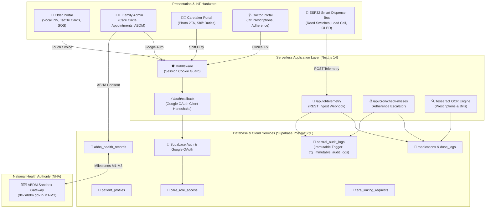

# CareSync Architecture & Technical Specification

CareSync is designed around a zero-trust, privacy-scoped healthcare architecture built on **Next.js 14 App Router**, **Supabase PostgreSQL**, **ESP32 IoT telemetry**, and **India's Ayushman Bharat Digital Mission (ABDM)** standards.

---

## 🏛️ High-Level System Architecture



---

## 🔐 4-Role Access Control Matrix

CareSync enforces strict principle-of-least-privilege boundaries:

| Resource / Action | 👴 Elder | 👨‍👩‍👧 Family Child | 🧑‍⚕️ Caretaker | 🩺 Clinical Doctor |
| :--- | :---: | :---: | :---: | :---: |
| **Pill Dispense Confirmation** | ✅ (1-Click / Vocal) | 👁️ (View Telemetry) | ✅ (Photo 2FA) | 👁️ (Adherence Logs) |
| **Prescription Modification** | ❌ (Read Only) | ❌ (Read Only) | ❌ (Strictly Locked) | ✅ (Full Rx Control) |
| **ABDM / ABHA Health Locker** | ✅ (Full Consent) | 👁️ (Shared View) | ❌ (Locked) | 👁️ (Doctor Consent Only)|
| **Medical Bills & Receipts** | 👁️ (View) | ✅ (Upload & Track) | ❌ (No Access) | ❌ (No Access) |
| **Emergency SOS Countdown** | ✅ (Trigger/Cancel) | 🚨 (Instant Alert) | 🚨 (Instant Alert) | 🚨 (Location + Medical ID) |
| **Audit Ledger Visibility** | 👁️ (Scoped to Circle)| 👁️ (Scoped to Circle) | 👁️ (Duty Actions Only)| 👁️ (Scoped to Circle) |

---

## 🤝 Care Circle Multi-Tenant Privacy Model

Each family circle is strictly partitioned:
* Every database query filters by `patient_id === currentPatientId`.
* **Zero Cross-Family Leakage**: Family members linked to Elder A cannot inspect the doses, logs, doctors, or receipts of Elder B.
* **LinkedIn-Style Connection Requests**:
  1. Child/Doctor/Caretaker searches for an elder by verified mobile number (`+91 XXXXXXXXXX`).
  2. If found, a `care_linking_requests` record is created in `PENDING` status.
  3. The request surfaces **at the very top** of the Elder Portal home view.
  4. The elder accepts or declines with one click. Only upon acceptance is the user linked to that elder's Care Circle.

---

## 📡 IoT Hardware Architecture & Telemetry Flow

The ESP32 Smart Dispenser Box contains 4 physical compartments:
1. **Compartment Sensor Array**:
   * **Magnetic Reed Switches**: Detects lid open (`LOW`) and lid sealed (`HIGH`).
   * **Load Cell Strain Gauge**: Measures milligram weights (`2.4g Loaded` $\rightarrow$ `0.0g Lifted`).
   * **Tri-Color LED Diodes**: Slot illumination (Green = Verified, Amber = Ready, Red = Missed).
   * **OLED Dot-Matrix Screen**: Telemetry readout (`2.4GHz WiFi`, `Weight`, `POST /api/iot/telemetry`).
2. **Telemetry Ingest Contract (`POST /api/iot/telemetry`)**:
```json
{
  "device_id": "ESP32_DISPENSER_01",
  "api_key": "CARESYNC_IOT_KEY_99882",
  "slot_number": 2,
  "weight_delta_grams": -2.4,
  "lid_state": "OPENED_THEN_CLOSED",
  "timestamp": "2026-11-15T10:30:00Z"
}
```
3. **Database Handshake**:
   * Transitions `dose_logs.status` $\rightarrow$ `SENSOR_VERIFIED`.
   * Sets `dose_logs.verification_method` $\rightarrow$ `IOT_BOX`.
   * Resets `medications.consecutive_misses` $\rightarrow$ `0`.
   * Appends immutable record to `central_audit_logs`.

---

## 🛡️ Central Audit Log Immutability Trigger

To guarantee audit ledger integrity and compliance with healthcare audit frameworks, `central_audit_logs` is protected by a PostgreSQL trigger that prohibits `UPDATE` or `DELETE` operations at the database engine level:

```sql
CREATE OR REPLACE FUNCTION prevent_audit_log_modification()
RETURNS TRIGGER AS $$
BEGIN
    RAISE EXCEPTION 'CENTRAL AUDIT LEDGER IS IMMUTABLE: UPDATE and DELETE operations are strictly prohibited on central_audit_logs table.';
    RETURN NULL;
END;
$$ LANGUAGE plpgsql;

CREATE TRIGGER trg_immutable_audit_logs
BEFORE UPDATE OR DELETE ON central_audit_logs
FOR EACH ROW
EXECUTE FUNCTION prevent_audit_log_modification();
```
Even database superusers or compromised API routes cannot rewrite, alter, or remove historical compliance logs.
