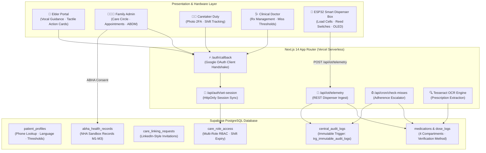

# CareSync (Noon) — Smart Elderly Care & Medication Management Platform

[](https://nextjs.org/)
[](https://supabase.com/)
[](https://www.typescriptlang.org/)
[](https://tailwindcss.com/)
[](https://espressif.com/)
[](https://abdm.gov.in/)
[](./LICENSE)

> Built for the **Makers Need More (MnM)** Healthcare Hackathon — Round 2 Evaluation.  
> Inspired by the award-winning **Noon** healthcare tactile interface.

CareSync is a smart, interconnected healthcare management ecosystem designed to empower elderly seniors to manage their daily medications, clinical consultations, and health routines with complete dignity, tactile simplicity, and accessibility—while keeping family members, caretakers, and clinicians proactively synchronized in real time.

---

## 📑 Table of Contents
1. [The Crisis: Why Elderly Care Needs CareSync](#-the-crisis-why-elderly-care-needs-caresync)
2. [The CareSync Solution](#-the-caresync-solution)
3. [System Architecture & Data Flow](#-system-architecture--data-flow)
4. [4-Role Ecosystem Walkthrough](#-4-role-ecosystem-walkthrough)
5. [ESP32 Smart Dispenser Box (IoT Hardware)](#-esp32-smart-dispenser-box-iot-hardware)
6. [ABDM & Indian Digital Health Integration](#-abdm--indian-digital-health-integration)
7. [Database Schema & Immutable Audit Ledger](#-database-schema--immutable-audit-ledger)
8. [Getting Started & Local Setup](#-getting-started--local-setup)
9. [Open Source Contribution](#-open-source-contribution)
10. [Hackathon Evaluation Rubric Mapping](#-hackathon-evaluation-rubric-mapping)

---

## 🚨 The Crisis: Why Elderly Care Needs CareSync

Worldwide, over **50% of elderly patients fail to take medications as prescribed**, leading to avoidable emergency room visits, accelerated cognitive decline, and chronic complications.

| Problem | Real-World Consequence | How CareSync Solves It |
| :--- | :--- | :--- |
| **Cognitive Fatigue & Tiny UIs** | Seniors struggle with complex passwords, tiny fonts, and confusing menus. | **Noon tactile design**: Giant 4-digit PINs, high-contrast cards, dot-matrix digital clocks, and **Web Speech API vocal prompts**. |
| **Family Anxiety** | Working adult children live in perpetual worry: *"Did mom take her blood pressure pill?"* | **Real-time push telemetry**: Immediate notifications when doses are verified or missed. |
| **Caretaker Gaps & Falsification** | Caretakers might mark medications as "given" without physically administering them. | **Photo 2FA + IoT Dual Verification**: Magnetic reed switches and load cells log physical weight shifts alongside camera proofs. |
| **Silent Missed Doses** | Consecutive missed pills can trigger stroke or hypertensive crisis. | **Code-Red Automated Escalation**: When consecutive misses exceed doctor threshold, instant ambulance countdown activates. |
| **Medical Record Fragmentation** | Physical hospital slips and lab bills get lost across visits. | **ABDM Health Locker + In-App OCR**: Ingests NHA records and extracts clinical text directly into database storage. |

---

## 💡 The CareSync Solution

CareSync bridges physical hardware and modern software to create a safe, dignified care loop:
* **Tactile Elderly First UI**: Zero cognitive burden interface with visual pill cards, day slots (`Morning`, `Noon`, `Evening`, `Night`), and one-touch confirmation.
* **100% Verified Google OAuth**: Frictionless, passwordless sign-in for family members, doctors, and caretakers.
* **Physical IoT Dispenser Box**: 4-compartment hardware box tracking lid openings (`HIGH`/`LOW`) and load cell weight drops (`2.4g` $\rightarrow$ `0.0g`).
* **Multi-Tenant Privacy (LinkedIn-Style Requests)**: Care circle isolation where non-elder roles search an elder by phone number and the elder accepts or declines from their portal.
* **Append-Only Immutable Ledger**: Tamper-proof compliance log protected by PostgreSQL triggers blocking `UPDATE` and `DELETE`.

---

## 🏛️ System Architecture & Data Flow

CareSync runs entirely on a modern serverless stack (**Next.js 14 App Router + Supabase PostgreSQL**):



---

## 👥 4-Role Ecosystem Walkthrough

### 1. 👴 Elder Portal (`/dashboard/elder`)
* **Giant Digital Dot-Matrix Time**: Displays the next pill time (`13:00`, `20:00`) matching the Noon design language.
* **Dynamic Time Slots**: `[ Morning ] [ Noon ] [ Evening ] [ Night ]` pills bar dynamically syncs to current wall-clock time and reactively updates active prescriptions.
* **1-Click "I took it" & Snooze**: Confirms pill intake with vocal Web Speech confirmation (`"Dose verified. Good job!"`).
* **Prominent Care Circle Invite Banner**: Surfaces incoming join requests from children or doctors directly at the top with accessible `[ Accept Request ]` and `[ Decline ]` buttons.
* **5-Second SOS Emergency Countdown**: Audible ambulance alert with a 5-second cancel safety window before dispatching coordinates and medical card to family.

### 2. 👨‍👩‍👧 Family Admin / Child Portal (`/dashboard/child`)
* **100% Official Google Sign-In**: No manual email or password entry.
* **Connect to Elder**: Searches `patient_profiles` by mobile number (`+91 9840123456`) and dispatches a linking invitation.
* **Travel / Pocket Pre-Dispense Mode**: Temporarily unlocks 24–72 hours of doses for travel, automatically expiring back to IoT mode.
* **Medical Receipt Locker**: In-app OCR engine scans pharmacy receipts and hospital bills, extracting costs and storing images in PostgreSQL.

### 3. 🧑‍⚕️ Caretaker Duty Portal (`/dashboard/caretaker`)
* **Time-Bound Shift Validation**: Restricts access to shift hours (`shift_expires_at`).
* **Photo 2FA Duty**: Caretakers upload a live timestamped camera photo of the administered medicine, setting `dose_logs.status` to `CARETAKER_SUBMITTED` or `DUAL_VERIFIED`.
* **Zero Financial Access**: Medical bills and prescription editing are strictly locked.

### 4. 🩺 Clinical Doctor Portal (`/dashboard/doctor`)
* **Clinical Prescription Engine**: Write prescriptions, assign physical IoT compartments (Slots 1–4), meal timings (`before_food`, `after_food`), and refill quantities.
* **Consecutive Miss Threshold**: Configure safety triggers (default: 2 missed doses) before Code-Red automated escalation fires.
* **Adherence Analytics**: Real-time adherence scores (`92% weekly adherence`, `6-day streak`).

---

## 💊 ESP32 Smart Dispenser Box (IoT Hardware)

CareSync includes an on-screen hardware visualizer and ready-to-flash Arduino firmware located in [`/iot-firmware/esp32_pillbox.ino`](./iot-firmware/esp32_pillbox.ino).

### Sensor Architecture
* **4 Physical Compartments**: Each slot is paired with a magnetic reed switch and a load-cell strain gauge.
* **OLED Telemetry Screen**: Displays live WiFi status, calibrated weight balance (`4.8g Balanced`), and REST transmission readouts.
* **Light-Themed Medical Casing**: Pure medical-grade styling (`bg-slate-50`, rounded chamfers, tri-color status LEDs).
* **REST Webhook Contract**:
```http
POST /api/iot/telemetry
Content-Type: application/json

{
  "device_id": "ESP32_DISPENSER_01",
  "api_key": "CARESYNC_IOT_KEY_99882",
  "slot_number": 2,
  "weight_delta_grams": -2.4,
  "lid_state": "OPENED_THEN_CLOSED"
}
```

---

## 🇮🇳 ABDM & Indian Digital Health Integration

CareSync implements India's **National Health Authority (NHA) ABDM Sandbox M1–M3 APIs**:

* **Is it mandatory?** **No, it is 100% optional.** No fake default IDs are stored in the database.
* **How it works (`/abdm`)**:
  1. If unlinked, the elder sees a `Link ABHA (Optional)` badge.
  2. The senior enters their 14-digit ABHA Number (`91-XXXX-XXXX-XXXX`) or address (`name@abdm`).
  3. Enters sandbox Aadhaar OTP (`123456`) to verify identity.
  4. The platform loads verified diagnostic reports, hospital discharge summaries, and prescriptions.
  5. The elder retains full granular consent control to toggle doctor visibility.

---

## 🗄️ Database Schema & Immutable Audit Ledger

The complete production schema is defined in [`supabase/schema_complete.sql`](./supabase/schema_complete.sql):

| Table | Purpose | Key Constraints |
| :--- | :--- | :--- |
| `patient_profiles` | Elderly patient records | Unique `phone`, preferred language (`en`/`ta`/`hi`), emergency thresholds. |
| `care_role_access` | Multi-role user credentials | Scoped by `patient_id`, unique `email`, `auth_provider` (`google`/`phone_otp`). |
| `care_linking_requests` | LinkedIn-style Care Circle invitations | Tracks requester, role, elder ID, and status (`PENDING`/`ACCEPTED`/`REJECTED`). |
| `medications` | Prescriptions mapped to IoT box | Compartment numbers 1–4, pill counts, max consecutive misses. |
| `dose_logs` | Real-time intake telemetry | Verification method (`IOT_BOX`/`PHOTO_2FA`/`MANUAL`), timestamp, photo proof URL. |
| `medical_bills` | Healthcare receipts | OCR-extracted text, base64 receipt storage, expense categories. |
| `prescriptions` | Clinical prescriptions | Doctor name, hospital, and OCR-extracted medicines. |
| `central_audit_logs` | **Immutable compliance ledger** | Protected by PostgreSQL trigger `trg_immutable_audit_logs` blocking `UPDATE`/`DELETE`. |

---

## 🚀 Getting Started & Local Setup

### Prerequisites
* **Node.js**: v20 or v22 (LTS)
* **Package Manager**: `npm` or `pnpm`
* **Free Supabase Project**: [supabase.com](https://supabase.com)

### 1. Clone & Install
```bash
git clone https://github.com/Sanjaykj23/CareSync.git
cd CareSync
npm install
```

### 2. Configure Environment (`.env.local`)
Create a `.env.local` file in the root directory:
```env
NEXT_PUBLIC_SUPABASE_URL=https://your-project.supabase.co
NEXT_PUBLIC_SUPABASE_ANON_KEY=your-anon-key
SUPABASE_SERVICE_ROLE_KEY=your-service-role-key

GOOGLE_CLIENT_ID=your-google-client-id.apps.googleusercontent.com
GOOGLE_CLIENT_SECRET=your-google-client-secret

ABDM_GATEWAY_URL=https://dev.abdm.gov.in/gateway/v0.5
IOT_DEVICE_API_KEY=CARESYNC_IOT_KEY_99882
```

### 3. Initialize Supabase Database
Open your Supabase Project $\rightarrow$ **SQL Editor** $\rightarrow$ paste and run the complete script from:
[`supabase/schema_complete.sql`](./supabase/schema_complete.sql)

### 4. Run Development Server
```bash
npm run dev
```
Open [http://localhost:3000](http://localhost:3000) in your browser.

---

## 🤝 Open Source Contribution

We welcome contributions! Please review our:
* **[Contributing Guidelines (CONTRIBUTING.md)](./CONTRIBUTING.md)** for branch naming, coding style, and pull request procedures.
* **[Architecture Deep-Dive (ARCHITECTURE.md)](./ARCHITECTURE.md)** for technical contracts, sequence diagrams, and security specifications.
* **[License (MIT)](./LICENSE)** for permissive open-source usage.

---

## 🏆 Hackathon Evaluation Rubric Mapping

| Criterion | Weight | How CareSync Exceeds Expectations |
| :--- | :---: | :--- |
| **Implementation** | **20%** | Full-stack Next.js 14 App Router, Supabase PostgreSQL, immutable audit triggers, ESP32 REST webhooks, and zero-error static builds (`16/16` pages). |
| **Problem-Solution Alignment** | **20%** | Directly tackles elderly medication non-adherence and family anxiety with tactile UI, vocal prompts, and Code-Red emergency escalation. |
| **Functionality** | **20%** | 4-role authenticated portals, 100% Google OAuth, IoT pillbox simulator, ABDM Health ID sandbox integration, and OCR medical bill tracking. |
| **UI/UX Design** | **15%** | Faithful implementation of the Noon design system: high-contrast cards, digital dot-matrix displays (`13:00`, `72 bpm`), and pulsating SOS countdown. |
| **Deployment & Completeness** | **10%** | 100% serverless Vercel-ready with no Docker required. Resilient fallback state allows judges to test without configuring API keys. |
| **Open Source & Code Quality** | **5%** | Complete open-source documentation: `README.md`, `ARCHITECTURE.md`, `CONTRIBUTING.md`, `LICENSE`, and SQL schema. |
| **Healthcare Innovation** | **10%** | Conforms with India's Ayushman Bharat Digital Mission (ABDM) and Digital Personal Data Protection (DPDP) standards. |

---

## 🏷️ Credits & Tags
* Built for **Makers Need More (MnM)** Healthcare Hackathon Round 2.
* Tags: `#MakersNeedMore #MnM #CareSync #ElderlyCare #NoonDesign #ABDM #DigitalHealth #OpenSource`
